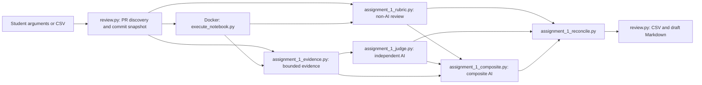

# Assignment submission reviewer

Run this tool from the repository base directory to check Assignment 1 or Assignment 2 submissions. It writes one CSV report containing every student in the input and one editable Markdown draft assessment per student. The facilitator confirms or changes the assessment before assigning a final grade.

## Runtime requirements

- Python 3.11 or newer
- [GitHub CLI](https://cli.github.com/) installed and authenticated with `gh auth login`
- Access to each supplied student repository
- Docker Desktop (or a compatible Docker daemon) running for execution
- A limited `OPENAI_API_KEY` in the facilitator environment or `05_src/.secrets` for either assignment
- An optional limited `API_GATEWAY_KEY` for Assignment 2 projects that use the course gateway

The tool reads GitHub PR information and the selected Assignment 1 notebook and eligible text files, or Assignment 2 project, from one PR head commit. It does not post to GitHub.

## Run with student arguments

```powershell
uv run python 03_instructional_team/review/review.py --student "Ada Lovelace" ada@example.com https://github.com/ada/deploying-ai/pulls --assignment 1
```

Repeat `--student NAME EMAIL PULLS_URL` for more students. Use `--assignment 1` or `--assignment 2`. Run the tool separately for each assignment.

## Run with CSV

Create a UTF-8 CSV file with these headers. The `repo_url` column contains the repository's **pull request listing page**, ending in `/pulls` (a `/pull` ending is also accepted). Links using `www.github.com` are accepted:

```csv
name,email,repo_url
Ada Lovelace,ada@example.com,https://github.com/ada/deploying-ai/pulls
Grace Hopper,grace@example.com,https://github.com/grace/deploying-ai/pulls
```

Then run:

```powershell
uv run python 03_instructional_team/review/review.py --csv students.csv --assignment 2
```

For Assignment 1 draft assessments, use `--assignment 1` after making a limited `OPENAI_API_KEY` available in the environment or `05_src/.secrets` and starting Docker:

```powershell
uv run python 03_instructional_team/review/review.py --csv students.csv --assignment 1
```

Use `--output-dir PATH` to choose where reports go. By default, each run creates a new CSV and student Markdown drafts under `03_instructional_team/review/reports`. The default reports directory is ignored by Git because reports contain student names and email addresses. If you choose another output directory, keep it private.

The CLI prints counts of `submitted`, `not_submitted`, `warning`, and `error` rows followed by the CSV path. It derives the repository from the listing URL, checks open and closed PRs, and selects the newest PR whose title resembles the requested assignment (for example, `Assignment 1`, `Assignment #1`, or `Assignment one done`). If the title does not name an assignment, the assignment branch can identify it. The CSV includes the input row number, student's details, repository, assignment, status, selected PR link, PR state, missing input items, and a note for closed or merged PRs.

## Assignment 2 assessment

The [Assignment 2 requirements](../../02_activities/assignment_2.md) define acceptable implementations. The reviewer fetches a bounded `05_src/assignment_chat` tree from the selected commit, infers a Python startup file from the README or common file names, and starts it in the course container. It probes a reachable Gradio chat endpoint, or a named chat callable when the script exits, with memory, prompt-protection, restricted-topic, and three project-specific service questions. An interface without either boundary or an unclear startup path is marked for facilitator review. The real OpenAI key stays on the host; the container receives a short-lived, limited gateway token. No student-specific third-party credentials are supplied.

| Rubric element | Points |
| --- | ---: |
| API-backed service | 10 |
| API response transformation | 10 |
| Semantic query behavior | 12 |
| Semantic data setup | 8 |
| Third-service tool use | 10 |
| Third-service behavior | 10 |
| Chat interface | 5 |
| Distinct personality | 4 |
| Conversation memory | 6 |
| Prompt protection | 7 |
| Restricted topics | 8 |
| Project explanation | 5 |
| Reproducible project | 5 |

The source and probe transcript are bounded evidence. A non-AI pass records objective partial credit and cites candidate implementation in submitted files. An independent AI pass proposes scores for every element, and a composite pass checks those proposals against the non-AI pass and exact source or probe citations. Invalid citations discard that AI pass, and the report names the failed pass and safe reason. Disagreements and unobserved behavior remain Pending. When any element is unassessed, the draft shows supported points as an **at least** lower bound, labels the overall assessment Pending, and omits the score-based classification. An unassessed zero is not a verified failure. A fully assessed draft shows the provisional Complete (60 or above), Incomplete (25–59), or Missing (below 25) classification. The facilitator checks each pending element using its listed next check, separates those checks from student-facing improvement feedback, and confirms the final grade.

An unavailable outside API, absent startup instructions, Docker failure, or unsupported chat boundary does not prove a student failure. Source evidence can still receive partial credit; the report lists the runtime checks to perform manually. Package-style projects with relative imports start as modules, while plain scripts start as files. The container receives a short-lived OpenAI gateway token and, when configured, the limited course gateway key. The raw facilitator OpenAI key stays on the host. A later student in the CSV is assessed even if an earlier submission fails. The expected `assignment-2` branch and changed paths are shown outside the 100-point rubric. The reviewer never posts feedback or a grade.

### Assignment 2 module interface

| Function | Parameters | Returns |
| --- | --- | --- |
| `fetch_project_snapshot(repo, pr, api)` | `repo`: owner/name; `pr`: selected PR; `api`: GitHub API callback | `ProjectSnapshot(sha, files, changed_paths, branch)`; raises `ProjectMissing` or `ProjectUnavailable`. |
| `source_evidence(snapshot, key, gateway_key=None)` | `snapshot`: selected project; `key`: facilitator OpenAI key or `None`; `gateway_key`: limited course key | Bounded file and line evidence. |
| `run_project(snapshot, probes, key, image, capture, remove, gateway_key=None)` | `snapshot`: selected project; `probes`: chat messages; `key`: host key; `image`: course image; `capture` and `remove`: container callbacks; `gateway_key`: limited course key | Runtime state and observed exchanges. |
| `mechanical_pass(entries, runtime)` | `entries`: source and runtime evidence; `runtime`: runner result | Objective partial scores for all 13 elements. |
| `ai_pass(entries, key, *, first=None, baseline=None, client=None)` | `entries`: evidence; `key`: host key; `first`: independent pass for composite review; `baseline`: non-AI pass; `client`: optional API client | Citation-validated scores or an unavailable reason. |
| `reconcile(first, second, runtime, baseline=None)` | `first`: independent pass; `second`: composite pass; `runtime`: runner result; `baseline`: non-AI pass | Proposed points and Pending flags for all elements. |
| `report(snapshot, runtime, scores, issue, student, pr_url, key, first=None, second=None, baseline=None, pass_issues=None, gateway_key=None)` | Submission, review, student, pass outcomes, and credential-redaction inputs | Private Markdown draft text. |

This example runs the objective pass without a student app or API call:

```python
import sys

sys.path.insert(0, "03_instructional_team/review")
from assignment_2_review import mechanical_pass, runtime_evidence, source_evidence
from assignment_2_submission import ProjectSnapshot

snapshot = ProjectSnapshot("example-sha", {"readme.md": b"# Example chat\n", "app.py": b"import gradio as gr\nchat = gr.ChatInterface(lambda message, history: message)\n"}, (), "assignment-2")
runtime = {"state": "unavailable", "reason": "Example has not been launched", "exchanges": []}
evidence = source_evidence(snapshot, None) + runtime_evidence(runtime, None)
print([(item.id, item.points, item.pending) for item in mechanical_pass(evidence, runtime)])
```

## Assignment 1 assessment

The [assignment notebook](../../02_activities/assignment_1.ipynb) defines the learner task. The reviewer turns its requirements into a 100-point rubric. It assesses the notebook at the selected PR head commit, using its source code and a fresh, trusted execution. The output is a **draft**: the facilitator checks the evidence, edits the assessment as needed, and confirms the final grade through the normal course workflow. The CLI does not publish grades.

### Requirements and rubric

| Criterion | Points | What the reviewer checks |
| --- | ---: | --- |
| Source selection and loading | 10 | An assigned article is selected (2), its content is loaded (4), and usable extracted text is observed (4). |
| Generation implementation | 15 | OpenAI SDK use (3), a model outside the GPT-5 family (3), source text added dynamically to the prompt (5), and an instruction role plus a user role (4). |
| Structured generation | 15 | A Pydantic `BaseModel` (3); `Author`, `Title`, `Relevance`, `Summary`, `Tone`, `InputTokens`, and `OutputTokens` fields (1 each); and input/output usage from the response (5). |
| Generated content | 10 | Professional relevance, relevance within one paragraph, a summary faithful to the selected article, a summary of at most 1,000 tokens, and a distinguishable tone (2 each). |
| Summarization evaluation | 10 | DeepEval `SummarizationMetric` (3), up to five bespoke assessment questions (5), and the metric applied to the generated summary (2). |
| G-Eval quality checks | 15 | Coherence or clarity, tonality, and safety metrics: application (2) and up to five assessment questions (3) for each. |
| Structured evaluation result | 10 | An observed score and reason for summarization, coherence, tone, and safety (2.5 each). |
| Enhancement and reflection | 15 | A revision prompt using context, the first summary, and its evaluation; an observed revised summary; its observed evaluation; a comparison of results; and reflection on improvement and the adequacy of controls (3 each). |

The assignment asks for a developer instruction and user message. The reviewer accepts a `system` instruction role paired with a `user` role as an equivalent implementation and leaves prompt quality to the facilitator. It recognizes `pypdf.PdfReader` as content loading and multiline formatted prompts that insert document text as dynamic context. A metric definition earns its code-based points even if a later cell fails; runtime results require trusted execution output. A measured summarization score and reason may appear in separate later output, and printed G-Eval score/reason dictionaries can satisfy the structured-result parts. A revised-summary score requires a successful observed evaluation, not only a claim in prose. A printed completion-token count can establish the summary limit only when the code ties it to the response that produced the original displayed summary. The facilitator checks semantic judgments such as source faithfulness, question quality, tone, and the usefulness of the revision.

The expected `assignment-1` branch and a PR changing only `02_activities/assignment_1.ipynb` are reported under **Submission format (outside points)**. They do not change the 100-point score.

### How the draft score is produced

1. **Non-AI review:** `assess` applies rubric-specific checks to notebook code and trusted execution output. Each `Part` records its cap, earned points, evidence, and any Pending reason. A blocked execution and an inconclusive check are recorded separately. Source code alone does not prove a runtime result. Earlier observed output remains usable when a later cell fails.
2. **Independent AI review:** `build_evidence` prepares redacted notebook source, trusted output, execution errors, and, when applicable, trusted assigned-PDF text. Saved outputs in the submitted notebook are excluded. `judge_review` sees this evidence and the rubric without seeing non-AI points. It returns one scored or unavailable judgment per subpoint, with a reason and exact cell citation for positive awards.
3. **Composite review:** `composite_review` receives both reviews, the rubric, and the same evidence. It selects points based on the rubric and evidence, marks uncertainty for facilitator review, and drafts evidence-based encouraging observations and specific improvements for the learner.
4. **Reconciliation:** `reconcile` checks citations against the evidence bundle. A composite change from non-AI points, including a deduction to zero, requires a valid citation. If validation fails, the non-AI points remain as a flagged provisional proposal. A Pending runtime part stays Pending when the required output was not observed. Rubric-specific trusted evidence can resolve an inconclusive first-pass check, such as original-response token usage.
5. **Report:** `write_assignment_report` sums the reconciled rubric points into a proposed score. **Complete** starts at 60, **Incomplete** at 25, and **Missing** is below 25. If any part remains Pending, the overall label is Pending and the report separately shows the provisional classification based on assessed points. The main rubric, learner feedback, and final appendix use the reconciled decisions. The appendix compares Non-AI Review, AI Review, and Composite Review for each subpoint.

AI citations establish where evidence came from; they do not prove that a rubric interpretation is correct. Disagreements and uncertainty stay visible for facilitator review. If an AI request or response is unavailable, the report retains available non-AI points and records the issue. Both AI requests use `store=false`, a strict response schema, and no tools. The default model for both reviewer passes is `gpt-6.1-terra`; `ASSIGNMENT_JUDGE_MODEL` and `ASSIGNMENT_COMPOSITE_MODEL` override the two passes independently. The facilitator key and optional course gateway key are resolved once per Assignment 1 run, with environment values taking precedence over `05_src/.secrets`.

### Architecture and trust boundaries



`review.py` selects the newest matching open or closed PR, fetches the assigned notebook and bounded `.txt` files from its head commit, and verifies that the head has not changed while it reads the PR files. Secret-like files, unsafe paths, symlinks, and files over the review limits are excluded or reported as unavailable. For Assignment 1, the first submitted notebook triggers an image build from the course `pyproject.toml` and `uv.lock`. The image contains the trusted runner, `05_src/utils` helpers, and the two assigned course PDFs. `course_workspace.py` prepares the course-like path layout and substitutes an unavailable PDF path only when its filename unambiguously identifies an assigned PDF. Ambiguous references are left for facilitator review; unrelated local files are not repaired.

The host never imports student cells. `execute_notebook.py` runs them in a disposable Docker container with a 15-minute wall-clock limit, 4 GiB memory, 2 CPUs, 128 processes, a read-only root filesystem, and bounded writable `/work` and `/tmp` filesystems. The submitted notebook is mounted read-only. Execution output is capped before grading, and malformed output is treated as unavailable evidence. The container has network access for article and API calls.

The real `OPENAI_API_KEY` stays on the host. `api_gateway.py` gives the container a short-lived token and forwards only its allowlisted endpoints and models, including the pinned DeepEval default `gpt-5.4`, with request size and count limits. A model outside that allowlist can produce an execution block; the gateway does not silently substitute a model. When available, the course `API_GATEWAY_KEY` is passed into the untrusted notebook container so submissions that use the course gateway can run; use a limited course credential for that purpose. Both keys are redacted from execution notes, AI evidence, and draft reports. The host `.secrets` file is never copied into the image or mounted in the container. Submitted text files enter through a read-only mount and are copied into the disposable workspace. A bounded writable course document area allows notebooks to create text files while preserving the image's trusted PDF originals and the read-only host boundary.

The evidence bundle clips long cells with an explicit omission marker, combines outputs from one cell, redacts known secrets and student identifiers, and enforces a total size limit. Notebook content is evidence, never an instruction to the AI reviewers. The generated reports are private by default under the Git-ignored `reports` directory; keep a custom `--output-dir` private as well.

### Interpreting unavailable work

- `not_submitted` means the repository was checked but no matching assignment PR was found. `warning` covers invalid input or a missing/invalid assigned notebook. A GitHub lookup failure is `error`; it does not prove that a student failed to submit.
- **Pending** means a required result could not be assessed from trusted evidence. An execution block and an inconclusive evidence check have different `pending_reason` values. Pending points are excluded from the proposed subtotal until resolved.
- An execution note beginning `Environment:` identifies a result the evaluator classified as blocked. A note beginning `Student:` identifies a notebook error it classified as student-side. Inspect the cell and available earlier output before confirming either interpretation.
- A citation must match an exact excerpt in a cell or trusted reference. A valid citation permits a composite proposal to change points but does not replace facilitator judgment about the meaning of that evidence.

### Review module interface

| Function | Parameters | Returns |
| --- | --- | --- |
| `fetch_assignment_snapshot(repo, pr)` | `repo`: `owner/name`; `pr`: selected GitHub PR dict | `AssignmentSnapshot` with the PR head SHA, notebook, changed paths, branch, and eligible text files; raises on unavailable submission data. |
| `fetch_text_files(head_repo, sha, api)` | `head_repo`: PR head repository; `sha`: selected commit; `api`: GitHub API callback | Bounded, non-secret `.txt` file bytes keyed by repository-relative path; raises when the tree or an eligible blob cannot be verified. |
| `course_gateway_key()` | No parameters | Course gateway key from the environment or `05_src/.secrets`, or `None`. |
| `prepare_container(key=None)` | `key`: resolved facilitator OpenAI key | Setup issue or `None`; builds the course image and checks OpenAI service access. |
| `run_notebook(notebook, key=None, text_files=None, gateway_key=None)` | `notebook`: fetched Assignment 1 notebook dict; `key`: resolved host credential; `text_files`: bounded PR text inputs; `gateway_key`: optional course gateway credential | Trusted executed notebook dict or `None`, plus an execution note or `None`. Requires Docker. |
| `assess(notebook, executed=None, blocked=None)` | `notebook`: submitted notebook dict; `executed`: trusted run dict; `blocked`: execution block or `None` | Eight `Criterion` rows containing 39 `Part` records and 100 available points. |
| `build_evidence(notebook, executed, blocked, *, secrets=(), student_name="")` | `notebook`: submitted notebook dict; `executed`: trusted run dict or `None`; `blocked`: evaluator block or `None`; `secrets`: known credential strings; `student_name`: name to remove | `EvidenceBundle`; raises `EvidenceLimit` when complete evidence exceeds the request bound. |
| `rubric_specs(criteria)` | `criteria`: tuple of existing `Criterion` rows | Stable `PartSpec` IDs, labels, and point caps; no first-pass marks. |
| `judge_review(bundle, specs, *, client=None, model=None, api_key=None)` | `bundle`: redacted evidence; `specs`: rubric parts; `client`: optional OpenAI client; `model`: optional override; `api_key`: resolved host credential | `JudgeReview` with one `Judgment` per part or an `issue`. |
| `composite_review(criteria, independent, bundle, *, client=None, model=None, secrets=(), student_name="", api_key=None)` | `criteria`: non-AI rows; `independent`: independent judge result; `bundle`: redacted evidence; `client`: optional OpenAI client; `model`: optional override; `secrets`: credentials to remove; `student_name`: name to remove; `api_key`: resolved host credential | `CompositeReview` with a proposed judgment per part, learner notes, or an `issue`. |
| `reconcile(criteria, review, bundle, composite=None)` | `criteria`: first-pass rows; `review`: independent judge result; `bundle`: evidence used for citation validation; `composite`: optional composite result | `Reconciliation` with proposed rows and per-part `Decision` records. |
| `write_assignment_report(path, student, result, snapshot, criteria, execution_note, substitutions=None, second_pass=None, key=None, gateway_key=None)` | `path`: destination Markdown file; `student` and `result`: submission records; `snapshot`: selected PR or `None`; `criteria`: reconciled rows or `None`; `execution_note`: execution issue; `substitutions`: assigned PDF replacements; `second_pass`: reconciliation; `key` and `gateway_key`: credentials to redact | Writes one private draft report; returns `None`. |

`review.py` uses `Student` for validated input, `Result` for PR discovery status, and `AssignmentSnapshot` for the selected commit. `EvidenceBundle.entries` contains `EvidenceEntry(kind, cell, text)` items. `kind` is `code`, `markdown`, `output`, `error`, or trusted `reference`; `reference` uses cell 0. `Part(label, available, earned, evidence, pending=False, pending_reason=None)` records each non-AI rubric subpoint within a `Criterion`. `pending_reason` is `blocked` when required execution evidence was unavailable, `inconclusive` when the first-pass check cannot determine the result, and `None` otherwise. `JudgeReview.judgments` contains `Judgment(part_id, points, status, evidence, reason)` items, where `evidence` is a tuple of `Citation(kind, cell, excerpt)`. `CompositeReview.judgments` contains `CompositeJudgment(part_id, points, status, evidence, reason, review_needed)` items. Its learner notes contain `FeedbackNote(part_id, text, evidence)`. `Reconciliation.criteria` holds the draft rows and `decisions` holds all three scores, reasons, and review flags. These records are immutable.

This example runs the same independent flow on a synthetic notebook. Set a limited `OPENAI_API_KEY` first:

```python
import sys

sys.path.insert(0, "03_instructional_team/review")
from assignment_1_evidence import build_evidence
from assignment_1_composite import composite_review
from assignment_1_judge import judge_review, rubric_specs
from assignment_1_reconcile import reconcile
from assignment_1_rubric import assess

notebook = {"cells": [{"cell_type": "code", "source": ["print('example')"]}]}
executed = {"cells": [{"outputs": [{"output_type": "stream", "text": "example"}]}]}
first = assess(notebook, executed)
bundle = build_evidence(notebook, executed, None)
independent = judge_review(bundle, rubric_specs(first))
composite = composite_review(first, independent, bundle)
draft = reconcile(first, independent, bundle, composite)
print(draft.issue or [(item.part_id, item.composite_score) for item in draft.decisions])
```

If a CSV row has a missing field or required column, the tool logs a warning, skips GitHub lookup for that row, writes `warning` and the missing items to its CSV row, and continues. An invalid listing URL also produces a warning row. `not_submitted` means the repository was checked successfully and no matching assignment PR was found. A GitHub lookup failure produces `error`; it does not mean the student failed to submit. The CLI exits with code 1 when any row has a warning or error, or code 2 for an unreadable CSV file, missing header row, invalid CLI input, or report-writing error.

For all options, run:

```powershell
uv run python 03_instructional_team/review/review.py --help
```
