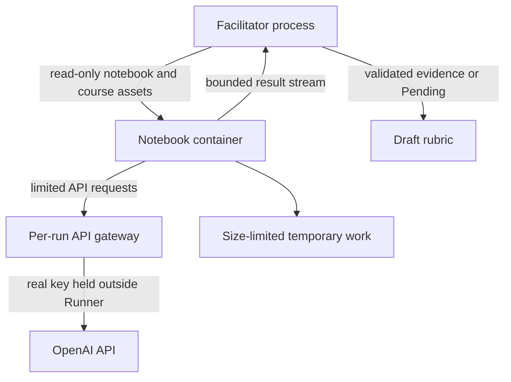

# PR 214 Review Findings - Plan

## Goal Capsule

- **Objective:** Facilitators can review Assignment 1 submissions without exposing their host or API credential, and students can run an Assignment 2 sample that meets its stated requirements.
- **Means:** Harden the evaluator's execution and evidence boundaries, then repair the sample application and its guidance (KTD1-KTD5).
- **Authority:** The Assignment 1 evaluator plan and `02_activities/assignment_1.ipynb` govern grading; `02_activities/assignment_2.md` governs the sample. The 11 Copilot threads on PR 214 and the two additional review findings define this remediation scope.
- **Execution profile:** One update to PR 214. The facilitator validates the draft grading behavior; the implementer completes code, tests, and documentation before requesting review.
- **Stop condition:** Do not run a submitted notebook with a writable host mount or a real API credential in its environment. If a safe execution path cannot support a required API call, mark the affected checks Pending.

---

## Product Contract

### Summary

This plan closes the review findings on PR 214. The evaluator will preserve per-student progress, treat missing execution evidence conservatively, and keep submitted code inside bounded resources. The Assignment 2 sample will use its own modules and demonstrate three allowed services with accurate submission instructions.

### Problem Frame

The current evaluator runs student code with a writable host directory and the facilitator's API key, and it trusts execution artifacts enough that malformed output can stop a batch. Several rubric checks can give or remove credit using evidence unrelated to the required response. The sample chat UI launches older course code and gives instructions that conflict with Assignment 2. These faults put facilitator resources and student assessments at risk.

### Requirements

**Execution and intake**

- R1. Submitted code cannot write to an unbounded host path, and all writable execution storage and exported output have enforced size limits.
- R2. Submitted code cannot read the facilitator's real API key; permitted API use has a per-run bound, and unavailable access leaves affected criteria Pending.
- R3. A wrapped GitHub Contents API Base64 payload decodes as a valid notebook while malformed payloads remain student-specific failures.
- R4. Malformed or oversized notebook execution artifacts cannot abort the batch or become grading evidence; later students still receive reports.
- R5. Classification considers every execution error and leaves service-blocked criteria Pending even when another cell has a student error.

**Rubric evidence**

- R6. Metric application credit recognizes both direct measurement and the course-taught `evaluate(test_cases=..., metrics=...)` form, independent of constructor keyword order.
- R7. Generated-content checks use the specific Relevance, Summary, and Tone fields; a Summary length decision uses token evidence or remains Pending.
- R8. Structured evaluation pairs earn runtime credit only from observable Score and Reason values for the same metric; unavailable output remains Pending when execution was blocked.
- R9. Semantic judgments, including source accuracy and question relevance, remain explicit drafts for facilitator confirmation rather than unsupported automatic passes.

**Assignment 2 sample**

- R10. The UI and graph import the `assignment_chat` implementation and preserve conversation history.
- R11. The sample refuses the three prohibited topic groups without invoking their tools or disguising the requested answer.
- R12. The sample demonstrates three distinct permitted services using the course dependencies and a shareable semantic-search data source.
- R13. The sample README matches `02_activities/assignment_2.md`, including the Assignment 2 branch and project-file submission.

### Acceptance Examples

- AE1. Given a submitted cell that writes beyond the execution storage cap, the run stops within its resource bound, records unavailable evidence, and leaves the host checkout and later student reports intact. Covers R1, R4.
- AE2. Given a submitted cell that prints its environment and makes a permitted OpenAI call, the call can succeed within the run allowance while the real key is absent from the cell's environment and outputs. Covers R2.
- AE3. Given a NameError followed by an API service failure, only the parts demonstrably caused by student code can receive zero; service-dependent parts remain Pending. Covers R5.
- AE4. Given source code that declares Score and Reason fields but produces no result, the structured evaluation pair earns no runtime credit. Covers R8.
- AE5. Given a question about a prohibited topic, the sample returns a refusal and makes no topic-tool call. Covers R11.

### Scope Boundaries

- The evaluator remains a facilitator draft tool. It does not publish final grades or change the original 100-point rubric.
- Assignment 2 grading remains PR discovery only; this plan repairs the sample, not an Assignment 2 evaluator.
- A general network sandbox for arbitrary student code is outside this update. The execution report must state that article access and non-OpenAI network calls remain possible.
- Changing course dependencies solely to support the sample is outside this update; the sample must use the locked environment.

---

## Planning Contract

### Key Technical Decisions

- KTD1. **Bounded notebook I/O.** Mount submission inputs read-only, run the notebook in a size-limited container temporary filesystem, and stream its result through a host reader with an explicit byte cap. Docker bind mounts are writable by default, and container memory limits account for tmpfs use. Do not rely on `docker cp` for tmpfs output, which Docker does not support. Governs R1, R4. [Docker bind mounts](https://docs.docker.com/engine/storage/bind-mounts/), [tmpfs mounts](https://docs.docker.com/engine/storage/tmpfs/), [container copy](https://docs.docker.com/reference/cli/docker/container/cp/).
- KTD2. **Mediate OpenAI access.** Keep the real key outside the notebook container. Provide a per-run, request-limited path for the SDK and DeepEval, with model and output limits, and stop it when the run ends. Test compatibility with the course fixture before grading depends on it; if compatibility fails, return Pending rather than falling back to key injection. A dedicated API project with an enforced spend limit is an additional financial bound, not a substitute for keeping the key out of submitted code. Governs R2. [OpenAI project controls](https://help.openai.com/en/articles/9186755-managing-projects-in-the-api-platform).
- KTD3. **Validate at trust boundaries.** Normalize only transport whitespace in Base64, then decode strictly. Validate notebook and execution artifact structure before traversal; malformed executed output is unavailable evidence, not an exception that escapes the per-student loop. Governs R3, R4. [Notebook schema and validation](https://nbformat.readthedocs.io/en/latest/api.html).
- KTD4. **Score from the owning evidence.** Match metric calls by parsed syntax where practical, associate output with the specific generated or evaluation field, and use a model-appropriate tokenizer on the extracted Summary field. Keep a runtime-dependent part Pending when its evidence cannot be established. Source text can show implementation intent but cannot prove a generated result. Governs R6-R9.
- KTD5. **Make the sample self-contained.** Route the UI and graph to their own prompt and tools, with a deterministic restricted-topic gate before model or tool dispatch. Use Open-Meteo weather as the API service, the repository's course documents as a small included persistent Chroma corpus for semantic search, and a unit-conversion function-calling tool as the third service; remove prohibited topic tools from the graph. Governs R10-R13. The Assignment 2 contract requires file persistence for a self-supplied dataset and does not expect graders to generate embeddings. [Open-Meteo API](https://open-meteo.com/en/docs).

### High-Level Technical Design

The execution path keeps untrusted input, writable work, and the API key in separate places:

Error attribution uses all cell errors. A malformed or oversized result follows the same unavailable-evidence path as a failed execution; a service blocker takes precedence for the parts it affects, while clear student failures remain visible for other parts.

### System-Wide Impact

- Facilitators need a bounded API project and the gateway prerequisite; documentation must explain how to detect unavailable execution without assigning zero.
- Students can receive different draft points after the evidence fixes. Facilitators should review changed reports before confirming grades.
- The Assignment 2 sample's semantic corpus must be small enough to commit and readable without a running database service.

### Risks and Dependencies

- The SDK or DeepEval may ignore a configured API endpoint. The integration fixture decides compatibility; the evaluator must fail closed to Pending for affected checks.
- A large notebook can still exhaust time or memory within its configured limits. The run must terminate, record a bounded diagnostic, and continue to the next student.
- A local gateway must be reachable only by the intended run and must enforce its own request limits; keeping a key outside the runner alone does not limit paid calls.
- The sample corpus and persisted index must be present in the PR. A build script alone would leave graders with an unusable semantic service.

### Sources and Prior Decisions

- `docs/plans/2026-11-12-1515-feat-assignment-1-evaluator-plan.md` defines the settled Docker choice, Pending behavior, facilitator confirmation, and rubric allocation.
- `03_instructional_team/review/review.py`, `assignment_1_rubric.py`, and their tests show the current execution and scoring seams; `05_src/assignment_chat` contains the sample's imports and instructions.
- [PR 214 review](https://github.com/UofT-DSI/deploying-ai/pull/214) contains the 11 Copilot comments; this plan also covers credential exposure and the incomplete third sample service found in the subsequent review.

---

## Implementation Units

### U1. Bound submitted notebook storage and output

- **Goal:** Keep notebook writes and returned evidence within configured resource limits.
- **Requirements:** R1, R4; AE1; KTD1.
- **Dependencies:** None.
- **Files:** `03_instructional_team/review/review.py`, `03_instructional_team/review/execute_notebook.py`, `03_instructional_team/review/tests/test_execution.py`, `03_instructional_team/review/tests/smoke_docker.py`.
- **Approach:** Replace the writable submission bind with read-only inputs and bounded temporary work. Stream results through a byte-limited host reader, preserve timeout and cleanup behavior, and treat an over-limit result as unavailable evidence.
- **Patterns to follow:** Existing per-notebook container naming and cleanup in `review.py`; the harmless smoke fixture.
- **Test scenarios:**
  1. Covers AE1. A fixture writes past the work limit; the host directory is unchanged, the container ends, and the next student can be processed.
  2. A fixture emits output beyond the result cap; host capture stays bounded and the rubric receives unavailable evidence.
  3. A valid fixture accesses the course PDF and returns an executed notebook within the cap.
  4. Timeout and interrupt remove the container and any gateway or temporary resources.
- **Verification:** A Docker smoke run proves the mount mode, storage bound, result cap, and cleanup on a real daemon; unit tests cover host-side limits.

### U2. Keep the real API credential outside submitted code

- **Goal:** Permit assignment API calls without exposing the facilitator key or allowing an unbounded run spend.
- **Requirements:** R2; AE2; KTD2.
- **Dependencies:** U1.
- **Files:** `03_instructional_team/review/review.py`, `03_instructional_team/review/execute_notebook.py`, `03_instructional_team/review/tests/test_execution.py`, `03_instructional_team/review/tests/smoke_docker.py`, `03_instructional_team/review/README.md`.
- **Approach:** Add a per-run API gateway outside the submitted-code container. Route supported SDK and DeepEval requests through it, enforce request and output bounds, and destroy its access when the run ends. Preserve preflight failure as an evaluator block.
- **Execution note:** Prove a harmless SDK and DeepEval call through the gateway before integrating rubric decisions; never test with a live student submission.
- **Patterns to follow:** `prepare_container` and the original plan's limited-credential prerequisite.
- **Test scenarios:**
  1. Covers AE2. The notebook can call the permitted API through a mock gateway while inspecting its environment reveals no real key.
  2. A call to an unapproved endpoint or beyond the run allowance fails and leaves affected checks Pending.
  3. A gateway outage or incompatibility leaves API-dependent parts Pending and later students continue.
  4. Logs, notebook output, and reports do not contain the real key.
- **Verification:** Unit and container fixtures prove key separation and bounded calls; a facilitator can configure a dedicated project with an enforced hard spend limit.

### U3. Validate fetched and executed notebooks per student

- **Goal:** Accept valid wrapped content and keep corrupt artifacts from stopping batch assessment.
- **Requirements:** R3, R4; KTD3.
- **Dependencies:** U1.
- **Files:** `03_instructional_team/review/review.py`, `03_instructional_team/review/tests/test_assignment_1.py`, `03_instructional_team/review/tests/test_execution.py`.
- **Approach:** Strip Base64 transport whitespace before strict decoding. Validate submitted and executed notebook shapes at the boundary, and convert malformed or oversized results to a student-scoped unavailable-evidence reason.
- **Patterns to follow:** `fetch_assignment_snapshot` and the existing per-student `LookupFailure` and `NotebookMissing` handling.
- **Test scenarios:**
  1. A line-wrapped Contents API payload produces the same snapshot as its unwrapped form.
  2. Invalid Base64 remains a student-specific notebook failure.
  3. `{"cells":[null]}` or non-dictionary outputs cannot raise from the batch loop and do not earn points.
  4. A malformed result for one student still produces that student's report and a valid report for the next student.
- **Verification:** Boundary and batch tests cover the input and output shapes without executing student code on the host.

### U4. Correct execution-error attribution

- **Goal:** A service failure cannot be hidden by an earlier student error.
- **Requirements:** R5; AE3; KTD4.
- **Dependencies:** U3.
- **Files:** `03_instructional_team/review/review.py`, `03_instructional_team/review/assignment_1_rubric.py`, `03_instructional_team/review/tests/test_execution.py`, `03_instructional_team/review/tests/test_assignment_1.py`.
- **Approach:** Retain all cell errors with their cell numbers and classify blockers across the full run. Pass the relevant blocking evidence to scoring without erasing separate clear student errors.
- **Patterns to follow:** Current `run_notebook` error extraction and `part(..., runtime=True)` Pending behavior.
- **Test scenarios:**
  1. Covers AE3. NameError followed by APIConnectionError leaves service-dependent parts Pending.
  2. A lone clear NameError records student evidence for affected parts without making unrelated source-verifiable parts Pending.
  3. An ambiguous exception remains Pending with a bounded diagnostic.
- **Verification:** Tests assert per-part status and the overall grade label for mixed failures.

### U5. Tie rubric points to the required evidence

- **Goal:** Metric and generated-content credit reflects the relevant result, not unrelated text or declarations.
- **Requirements:** R6-R9; AE4; KTD4.
- **Dependencies:** U3, U4.
- **Files:** `03_instructional_team/review/assignment_1_rubric.py`, `03_instructional_team/review/tests/test_assignment_1.py`.
- **Approach:** Recognize supported metric application syntax from the course examples. Extract the named generated and evaluation fields from structured results, distinguish token usage from word count, and leave unobservable semantic or length judgments Pending for facilitator review.
- **Patterns to follow:** The rubric point allocations in the original evaluator plan and examples in `02_activities/assignment_1.ipynb` and `01_materials/labs/02_4_eval_ai_judge.ipynb`.
- **Test scenarios:**
  1. A course-style `evaluate(test_cases=..., metrics=[metric])` and a `GEval` constructor with reordered keywords receive application credit.
  2. An article printout containing blank lines or Summary-like text cannot change the Relevance or Summary score.
  3. A Summary over 1,000 model tokens cannot pass because its word count is shorter; missing token evidence stays Pending.
  4. Covers AE4. Source declarations without an executed Score and Reason pair earn no runtime points.
  5. A setup-blocked output remains Pending while supported source-only points remain assessed.
- **Verification:** Representative notebooks show each subpoint's evidence, point cap, Pending status, and total before a facilitator confirms grades.

### U6. Repair the Assignment 2 sample and guidance

- **Goal:** The sample launches its own working three-service chat and follows the assignment restrictions.
- **Requirements:** R10-R13; AE5; KTD5.
- **Dependencies:** None.
- **Files:** `05_src/assignment_chat/app.py`, `05_src/assignment_chat/main.py`, `05_src/assignment_chat/prompts.py`, `05_src/assignment_chat/tools_music.py`, `05_src/assignment_chat/tools_animals.py`, `05_src/assignment_chat/tools_horoscope.py`, `05_src/assignment_chat/readme.md`, `05_src/assignment_chat/tests/test_app.py`, `05_src/assignment_chat/tests/test_tools.py`, plus weather, course-search, and unit-conversion tools and a persisted index under `05_src/assignment_chat/`.
- **Approach:** Make the app and graph import local modules. Gate restricted topics before model or tool dispatch and remove the prohibited tools from the graph. Add a weather API tool that rephrases the response, a unit-conversion function-calling service, and a persistent Chroma index of included course documents; then correct the README's service and submission instructions.
- **Patterns to follow:** `02_activities/assignment_2.md` for the three services, guardrails, dependencies, and submission format; the existing Gradio history conversion in `app.py`.
- **Test scenarios:**
  1. The app invokes `assignment_chat.main` and preserves a two-turn conversation in the graph input.
  2. Covers AE5. Cat/dog, horoscope/Zodiac, and Taylor Swift requests each receive a refusal with no tool call.
  3. A weather question calls the API tool and returns a rephrased forecast; an API failure yields a clear error.
  4. An allowed semantic question retrieves from the included index without a running Chroma or Postgres server.
  5. The third service is invoked by function calling and returns a useful result without new dependencies.
  6. The README names the Assignment 2 branch and project files, and a cold checkout can launch the sample with its documented prerequisites.
- **Verification:** Mocked graph/tool tests plus one cold-checkout sample smoke run cover imports, local data, guardrails, and setup instructions.

---

## Verification Contract

| Check | Scope | Done signal |
| --- | --- | --- |
| `python -m unittest discover -s 03_instructional_team/review/tests -v` | U1-U5 | Existing and new evaluator tests pass, including wrapped input, malformed output, mixed errors, and scoring fixtures. |
| Harmless Docker fixture | U1-U2 | Input is read-only; storage, result, time, and API-call bounds hold; no real key reaches student code. |
| Two-student mocked CLI run | U3-U5 | A bad first submission cannot prevent a complete second report, and unsupported points remain Pending. |
| Assignment 2 sample tests and cold-checkout smoke run | U6 | The app loads its own graph, all three allowed services work, restricted requests make no tool calls, and documented setup suffices. |
| Facilitator report review | U4-U5 | Each changed rubric award cites the correct field or source cell, and uncertain judgments remain editable drafts. |

Live student submissions and paid API calls are outside local verification. Any optional live credential check uses a bounded project and a harmless fixture.

---

## Definition of Done

- All 11 Copilot comments and the two additional findings have a corresponding implemented fix or an explicit, verified Pending path.
- The evaluator completes a mixed-quality batch without host-disk exposure, credential disclosure, unbounded capture, or unsupported automatic runtime credit.
- The Assignment 2 sample runs from a fresh checkout with three permitted services and accurate instructions.
- Tests and smoke checks in the Verification Contract pass; facilitator review confirms the draft grading changes.
- Dead-end scaffolding and unused imports from abandoned approaches are removed from the PR diff.
