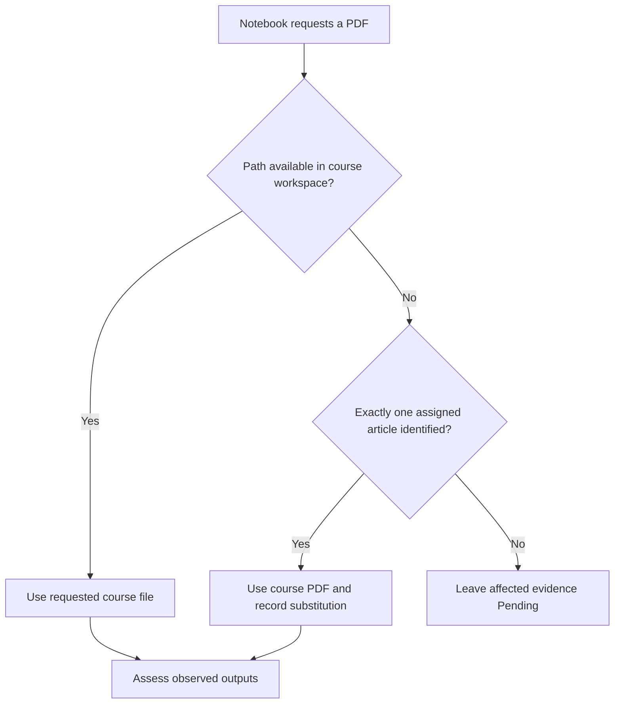
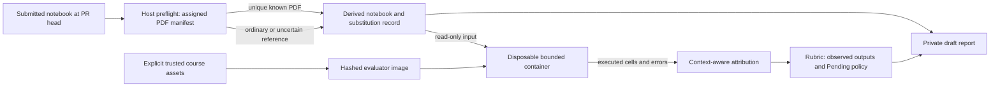
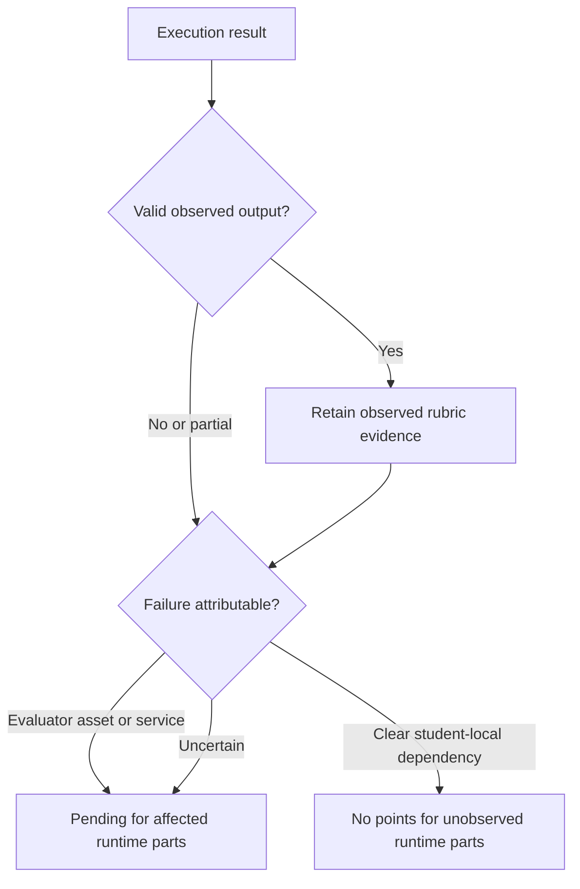

# Assignment 1 Execution Compatibility - Plan

## Goal Capsule

- **Objective:** Facilitators can obtain useful, evidence-based draft assessments from Assignment 1 notebooks that use the course workspace and assigned articles.
- **Product authority:** `02_activities/assignment_1.ipynb` defines the assignment; `docs/plans/2026-11-12-1515-feat-assignment-1-evaluator-plan.md` defines the rubric and draft-grading policy. The five-submission trial identifies the compatibility failures this plan addresses.
- **Open blockers:** None for planning. A later student-code or service failure may still leave an individual assessment Pending.
- **Means:** Package a trusted course workspace, resolve only identifiable assigned-PDF references, and classify execution failures from their context (KTD1-KTD3).
- **Execution profile:** One PR on the active evaluator branch; implementation and local verification end before any publication decision.
- **Authority and stop conditions:** The Product Contract and the two earlier plans govern rubric and security behavior. Stop if the implementation would require mounting the host checkout, exposing the real credential, or guessing an article.

---

## Product Contract

### Summary

The evaluator will present the expected course workspace to submitted notebooks while retaining its execution limits. It will use a known assigned PDF when a notebook points to an unavailable machine-specific copy, record that substitution, and distinguish evaluator failures from student-specific failures in draft reports.

### Problem Frame

A controlled trial fetched five Assignment 1 PRs, but none reached generated-result scoring. Two notebooks could not import the course `utils` package, two required repository context that the container did not provide, and one referred to a PDF path on the student's computer. All five reports stayed Pending, so the facilitator could not use their runtime evidence to confirm grades. The current image contains the course PDFs and runner but omits course helpers, and notebook cells start in `/work` without the expected repository layout.

### Key Decisions

- **Execute submitted notebooks in the course environment** (session-settled: user-directed — chosen over static inspection alone because generated outputs matter). Governs R1, R2.
- **Keep evaluator failures Pending** (session-settled: user-directed — chosen over automatic zero because students should not lose credit for missing evaluator assets). Governs R5, R6.
- **Use the course workspace** (session-settled: user-directed — chosen over an evaluator-specific environment because the assignment teaches course imports and paths). Governs R1, R2.
- **Substitute a known assigned PDF** (session-settled: user-directed — chosen over scoring the blocked work as missing or leaving that case Pending so the evaluator can observe the student's remaining work). Governs R3, R4.
- **Facilitator confirms final grades** (session-settled: user-directed — chosen over automatic final grading because the rubric includes semantic judgments). Governs R6.
- **Use trusted course files by default.** The evaluator supplies the course material needed by the assigned notebook, not an unrestricted snapshot of the student's repository. Governs R1, R2, R7.

### Actors

- A1. The facilitator selects Assignment 1 submissions, reviews draft evidence and substitutions, and confirms grades.
- A2. The student submits the assigned notebook in a PR.
- A3. The evaluator prepares a bounded execution workspace, runs the notebook, and writes a draft report.

### Requirements

**Course workspace and isolation**

- R1. Submitted notebooks can import the trusted course helpers and use the repository-relative paths taught for Assignment 1.
- R2. Workspace compatibility preserves the existing read-only submission input, bounded writable storage and output, and separation of the facilitator's real API credential from submitted code.

**Assigned article resolution**

- R3. When a notebook requests an unavailable machine-specific PDF path that unambiguously identifies one assigned article, the evaluator supplies the corresponding course PDF and continues execution.
- R4. The draft report identifies the substituted article and affected notebook cell without exposing the student's full local machine path.
- R5. An ambiguous path or unavailable course asset is never silently substituted or treated as proof of student failure; affected runtime checks remain Pending with a clear reason.

**Assessment and batch behavior**

- R6. The draft leaves evaluator setup failures Pending and gives no points for runtime results missing because of a clear student-specific failure, while retaining credit for earlier observed results and facilitator control of the final grade.
- R7. Failure or substitution for one student does not change another student's workspace or stop later reports in the batch.

### Key Flows

- F1. **Run a course-compliant notebook.** The evaluator finds the PR notebook, supplies the trusted course workspace, runs it within the existing limits, and cites observed results in the draft report. Covers R1, R2, R6.
- F2. **Resolve a local PDF reference.** A missing machine-specific path is matched to one assigned article, the course copy is used, and the report records the substitution before assessing later outputs. Covers R3, R4, R6.
- F3. **Handle uncertain or failed execution.** An ambiguous path or missing evaluator asset leaves affected parts Pending; a clear student-specific failure is identified for facilitator review; the next student is still processed. Covers R5-R7.

### Acceptance Examples

- AE1. **Covers R1, R2.** A notebook using the course `utils` helper and a repository-relative course path reaches its next cell in the bounded container, without a writable host checkout or real API key in the notebook environment.
- AE2. **Covers R3, R4, R6.** A notebook requests a missing absolute copy of an assigned PDF; the evaluator uses that article's course copy, records the substitution without the full local path, and assesses only outputs it subsequently observes.
- AE3. **Covers R5, R6.** A path could refer to more than one assigned article, or the corresponding course file is absent; the report explains the uncertainty and leaves affected runtime parts Pending.
- AE4. **Covers R6, R7.** One notebook fails because the student references an unrelated local file; unobserved affected runtime results receive no points, earlier observed results remain credited, and the next student's report is still produced.
- AE5. **Covers R2, R7.** A notebook attempts to write outside the bounded workspace or inspect the facilitator's real credential; the host remains protected, output stays capped, and later submissions continue.

### Success Criteria

- A controlled rerun of the five sampled PR heads no longer stops at the observed missing course helper or repository-context failures; the assigned-PDF case records a substitution and proceeds. Later notebook or service failures remain visible and do not count as a promise of a complete grade.
- A report never turns an evaluator setup failure into an automatic zero or gives runtime credit from source code alone.

### Scope Boundaries

- The evaluator does not fetch and execute arbitrary student-repository support files as part of the default workspace.
- It does not guess an article from an ambiguous path or repair unrelated local file references in student code.
- This work does not change rubric point allocations, publish grades, or make Assignment 2 executable.

### Dependencies and Assumptions

- The trusted course checkout contains the helpers and assigned PDFs required by the Assignment 1 instructions.
- A limited API credential and reachable services are needed to observe API-dependent results; their absence follows the existing Pending policy.
- The five-submission trial is a compatibility sample, not proof that every later notebook will complete.

### Sources and Research

- `02_activities/assignment_1.ipynb` specifies the assigned articles and shows the course-relative secrets reference.
- `docs/plans/2026-11-12-1515-feat-assignment-1-evaluator-plan.md` establishes notebook execution, course-environment parity, Pending treatment, and facilitator confirmation.
- `docs/plans/2026-11-14-1714-fix-pr-214-review-findings-plan.md` establishes bounded storage, read-only inputs, mediated API access, and observed-output scoring.
- `03_instructional_team/review/Dockerfile`, `execute_notebook.py`, and `review.py` show the current image contents, execution directory, and error classification.
- A private five-submission trial on 2026-11-15 supplied the observed failure cases; student reports remain outside the repository.

## Planning Contract

Product Contract preservation: R1-R7, F1-F3, and AE1-AE5 retain their confirmed meaning; this section fixes the implementation approach without changing the rubric.

### Key Technical Decisions

- KTD1. Build a minimal trusted course tree into the evaluator image and expose its expected relative layout from the bounded per-run workspace. The image owns course helpers and assigned PDFs; the notebook's writable current directory remains on `/work`, and submitted files remain read-only under `/input`. This implements R1-R2 and the course-workspace decision without mounting the host checkout. Docker documents that `--read-only` limits writes to explicitly writable mounts and that tmpfs data counts toward the container memory limit. [Docker run reference](https://docs.docker.com/reference/cli/docker/container/run/), [tmpfs reference](https://docs.docker.com/engine/storage/tmpfs).
- KTD2. Before execution, resolve explicit notebook PDF path references against a fixed manifest of the two assigned PDFs. Substitute only when the unavailable path identifies exactly one manifest entry; execute a derived notebook copy, preserve the submitted source for grading, and return structured cell/article substitution records to the host report. Dynamic or ambiguous references receive no guessed replacement. This implements R3-R5 (session-settled: user-directed — chosen over leaving an identifiable assigned article Pending: the facilitator needs the later runtime evidence).
- KTD3. Attribute failures using the failed cell, exception details, PDF resolver outcome, known course assets, and service indicators rather than exception class alone. A missing trusted helper or assigned course asset is an evaluator block; a clear unrelated student-local file or helper reference is a student failure; unresolved attribution remains Pending. Preserve the current grader's observed-output rule and pass only evaluator blocks as `blocked`. This implements R5-R6 (session-settled: user-directed — chosen over automatic zero for evaluator failures: the student did not cause those failures).
- KTD4. Keep image inputs explicit and hash every copied file in the image tag; exclude `.secrets`, reports, and arbitrary student repository files. Reuse the gateway token, read-only input mount, output caps, tmpfs caps, and per-student container lifecycle. This implements R2 and R7.

### High-Level Technical Design

The notebook runs from an Assignment 1 directory inside the bounded workspace. Relative course paths resolve to image-owned trusted assets, while writes remain in the bounded workspace. The host passes a gateway token to the container; the real API credential stays with the host.

### Sequencing and Impact

Workspace packaging precedes PDF resolution and failure attribution because both depend on a canonical assigned-asset manifest. The report must receive substitution records and sanitized failure details before the private sample rerun. This changes the facilitator's draft report and the Docker image cache; it does not change PR lookup, the rubric's point allocations, or Assignment 2 discovery.

### Risks and Implementation-Time Decisions

- A notebook can construct a PDF path dynamically. KTD2 intentionally limits substitution to references whose target can be established before execution; the report must make unresolved cases visible as Pending under R5.
- A failed cell can have several causes. KTD3 requires a conservative attribution and tests for mixed student and service errors so an unrelated local path is not mislabeled as an evaluator setup failure.
- Keep the current CPU, memory, process, time, output, and API gateway limits as regression gates. A course-tree layout that requires a writable host bind mount fails R2.
- Choose the smallest sandbox-local alias or derived-source mechanism that gives the expected relative paths. The exact helper boundaries and notebook metadata format may be settled during implementation, while the behavior in KTD1-KTD2 stays fixed.

## Implementation Units

### U1. Package and expose the trusted course workspace

- **Goal:** Course-compliant Assignment 1 cells can import `utils.clients` and find course-relative files within the bounded container.
- **Requirements:** R1, R2, R7; F1; AE1, AE5; KTD1, KTD4.
- **Files:** `03_instructional_team/review/Dockerfile`, `review.py`, `execute_notebook.py`, `tests/test_execution.py`, `tests/smoke_docker.py`.
- **Approach:** Define an explicit allowlist of required course assets, copy it into the image build context, include each source in the image digest, and prepare the expected working-directory layout under `/work` for each run. Keep optional `%dotenv` references from requiring a host `.secrets` file.
- **Test scenarios:**
  - Covers AE1. A notebook imports the trusted helper and reads a course-relative assigned PDF, then reaches its next cell in the container.
  - Covers AE5. A notebook attempts a host checkout or real-key read; it cannot access either, and the next submission starts with a clean workspace.
  - Changing one packaged helper changes the image tag; a `.secrets` file never enters the build context or tag inputs.
  - A notebook writes a temporary file in its working directory without changing the read-only input or image-owned course assets.
- **Verification:** A Docker smoke run proves import and relative path behavior; command-level tests prove the resource mounts and gateway-token boundary. The smoke seam catches container layout errors that mocks miss, while it does not prove remote API availability.
- **Execution note:** Prove the container layout with a smoke scenario before relying on mocked build-command tests.

### U2. Resolve identifiable assigned-PDF paths and record substitutions

- **Goal:** A notebook with an unavailable machine-specific copy of an assigned article reaches later cells, and the facilitator sees what was substituted.
- **Requirements:** R3-R5, R7; F2-F3; AE2, AE3; KTD2.
- **Files:** `03_instructional_team/review/review.py`, `execute_notebook.py` or a focused resolver module beside it, `tests/test_execution.py`, `tests/test_assignment_1.py`.
- **Approach:** Use the same assigned-PDF manifest as U1. Resolve only explicit references identifying exactly one entry, execute a derived copy, and pass cell/article records into the report without the original absolute path. Preserve the submitted notebook as the source of rubric citations.
- **Test scenarios:**
  - Covers AE2. A missing absolute path with one assigned PDF's known identity uses the course copy, and the report names its cell and article without a home-directory path.
  - Covers AE3. A generic or multi-match PDF name remains unsubstituted and leaves affected runtime evidence Pending with a clear reason.
  - A known article absent from the trusted image is reported as evaluator unavailable rather than silently replaced with a different file.
  - An unrelated local PDF path is not rewritten; its later failure is available for U3 attribution.
  - Two sequential notebooks receive independent substitution records.
- **Verification:** Unit scenarios prove deterministic matching and redaction; a Docker scenario proves the substituted file is actually read before later outputs are assessed.

### U3. Attribute failures and preserve observed evidence

- **Goal:** Draft reports distinguish evaluator blocks from clear student-specific failures without awarding unobserved runtime points.
- **Requirements:** R5-R7; F3; AE3, AE4; KTD3.
- **Files:** `03_instructional_team/review/review.py`, `assignment_1_rubric.py` only if needed to retain partial evidence, `tests/test_execution.py`, `tests/test_assignment_1.py`.
- **Approach:** Replace exception-name-only attribution with context from the failing cell and known asset/service boundaries. Feed evaluator blocks to `assess(..., blocked=...)`; keep student failures visible without blocking all runtime parts, and preserve already observed output evidence.
- **Test scenarios:**
  - Covers AE4. An unrelated student-local file failure gives no credit for missing later runtime results, retains earlier observed result points, and permits the next student's draft.
  - A missing trusted `utils` import or assigned PDF remains Pending as an evaluator block.
  - A service error after a student `NameError` remains an evaluator block for affected runtime parts rather than being hidden by the earlier error.
  - An unfamiliar error with uncertain ownership remains Pending rather than automatically assigning blame.
  - Malformed or oversized execution output remains unavailable evidence and does not create source-only runtime credit.
- **Verification:** Existing rubric tests plus new attribution scenarios establish points and Pending labels; a two-student integration test establishes continuation and isolation.

### U4. Document and trial the facilitator workflow

- **Goal:** Facilitators can interpret substitutions and failure reasons in private drafts and confirm grades using the existing workflow.
- **Requirements:** R4-R7; F1-F3; AE2-AE4.
- **Files:** `03_instructional_team/review/README.md`, `tests/test_assignment_1.py`, `tests/smoke_docker.py`.
- **Approach:** Update the evaluator README for course assets, substitution limits, error labels, and review duties. Keep private student reports and credentials outside the repository. Rerun the five sampled PR heads after the automated gates pass.
- **Test scenarios:**
  - A draft shows the article and affected cell for a successful substitution but no machine-specific path.
  - A mixed batch writes each student's report even when an earlier notebook fails.
- **Verification:** Check that the five known import/context/PDF blockers are cleared or replaced by a later clearly explained failure; confirm that no evaluator setup failure becomes a zero and no report is published automatically. This is a compatibility sample, not a universal completion guarantee.

## Verification Contract

- Run targeted evaluator tests with `uv run python -m pytest 03_instructional_team/review/tests/test_execution.py 03_instructional_team/review/tests/test_assignment_1.py -v` and then the full suite with `uv run python -m pytest`. Use `uv run --active python` if the project environment is already active.
- Run `uv run ruff check` on changed Python files and `uv run pyrefly check` on changed Python files, following the project guide. Resolve findings introduced by this work.
- Run `03_instructional_team/review/tests/smoke_docker.py` through the project environment against a freshly built image. Confirm imports, relative paths, PDF substitution, read-only input, bounded writes, and output behavior in a real container.
- Privately rerun the five sampled PR heads with a limited credential, retain the reports outside Git, and inspect each draft for substitution detail, classification, observed-output scoring, and batch continuation. Do not treat remote service availability as proof of student failure.
- Review the diff against the earlier security plan: no host checkout mount, no real key in image/container arguments, and no unbounded output or writable host input.

## Definition of Done

- U1-U4 meet their listed verification outcomes, and R1-R7 are covered by automated evidence plus the five-submission compatibility trial where applicable.
- The evaluator README describes all changed public behavior and its examples remain accurate; no unrelated module README needs changing unless its public interface changes during implementation.
- The rubric's 100-point allocations, facilitator confirmation, private draft handling, and Assignment 2 discovery remain intact.
- No secrets or student reports enter the diff, and abandoned experiment code is removed before review.
