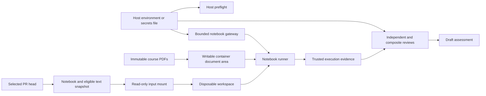

# Assignment 1 Evaluator Compatibility - Plan

## Goal Capsule

- **Objective:** Facilitators receive usable draft assessments when an Assignment 1 submission uses supported credentials, models, or text-file workflows.
- **Authority:** The Assignment 1 rubric governs scoring; the facilitator confirms final grades. The reviewer must preserve its credential and execution boundaries.
- **Open blockers:** None. U2 verifies the concrete notebook model IDs against the course requirements and gateway limits during implementation.
- **Execution profile:** One pull request; the implementer updates the reviewer, its targeted tests, and the module README together.

## Product Contract

### Summary

Make Assignment 1 setup independent of a notebook's credential usage, align the evaluator's AI model with the requested model, and support valid submission text files. Apply these rules to every selected submission rather than recognizing individual students or filenames.

**Product Contract preservation:** unchanged.

### Problem Frame

The current evaluator can block otherwise assessable work for reasons outside the student's assignment: a key stored in the course secrets file is unavailable to Assignment 1 setup, a notebook model can be rejected by the gateway, and a valid text-file workflow can hit a read-only course path. Those blocks leave runtime rubric items Pending and make the draft assessment less useful to the facilitator.

### Key Decisions

- **Cover both model paths** (session-settled: user-approved — chosen over changing only the evaluator model: the notebook gateway can independently reject a student's model). Governs R3, R4.
- **Support both text-file origins** (session-settled: user-approved — chosen over supporting only one origin: valid notebooks may create text files or read files committed with the PR). Governs R5, R6.
- **Use general rules** (session-settled: user-directed — chosen over submission-specific exceptions: the fixes must work for any submission). Governs R1-R7.
- **Supply the course gateway credential** (session-settled: user-approved — when present, make `API_GATEWAY_KEY` available to notebook execution while keeping `OPENAI_API_KEY` behind the bounded host proxy). Governs R2, R4.

### Requirements

**Credential availability**

- R1. Resolve the facilitator credential for every Assignment 1 evaluation before setup, even when the submitted notebook does not request it.
- R2. Prefer an explicitly supplied environment credential and use the course secrets file as a fallback; keep the real credential on the host and redact it from evidence and reports.
- R2a. Resolve the optional course `API_GATEWAY_KEY` from the environment or secrets file and supply it to the untrusted notebook container for course gateway calls; redact it from evidence and reports.

**Model access**

- R3. Use `gpt-6.1-terra` for the evaluator's independent and composite AI reviews unless a documented reviewer override is supplied.
- R4. Permit notebook requests for models allowed by the course evaluation policy through the bounded gateway, and identify a genuinely unsupported model as such without treating the gateway rejection as evidence of poor student work.

**Text-file workflows**

- R5. Make bounded, non-secret text files from the selected PR head available to the notebook at their expected submission paths.
- R6. Let a notebook create and read text files in its disposable workspace, including when its code targets a course document path, without granting writes to trusted course files or the host filesystem.
- R7. Apply the same path, size, and credential exclusions to every submission; do not special-case a student, file name, or PR.

**Review outcome**

- R8. When an evaluator limitation is removed, regenerate the draft from trusted execution evidence and recalculate affected Pending parts under the existing rubric.
- R9. Keep a genuine missing credential, unsupported model, unavailable file, or execution failure visible for facilitator review without awarding unobserved runtime points.
- R10. Update the reviewer documentation for credential resolution, reviewer models, gateway model policy, and supported text-file behavior.

### Key Flows

- F1. For a selected Assignment 1 PR, the evaluator resolves its host credential, captures the notebook and eligible text files at one head commit, prepares the isolated run, and produces non-AI, independent AI, and composite reviews. Covers R1-R8.
- F2. If setup or notebook execution still fails, the evaluator records the cause and leaves unobserved runtime work for facilitator review. Covers R9.

### Acceptance Examples

- AE1. **Covers R1-R3:** Given a valid course secrets file and no process environment key, an Assignment 1 notebook that never reads a secret still reaches both AI review passes using `gpt-6.1-terra`.
- AE2. **Covers R2:** Given both credential sources, the explicit environment value is used, and neither value appears in the execution evidence or draft report.
- AE3. **Covers R3, R4:** Given a notebook that requests a course-permitted model, its call reaches the gateway while the two evaluator review passes use their separately configured model.
- AE4. **Covers R4, R9:** Given a notebook that requests a model outside the course policy, the report identifies that request as unsupported and keeps dependent runtime results Pending.
- AE5. **Covers R5-R7:** Given a PR with an eligible text file, the notebook can read it at the selected commit; a secret file or unsafe path is excluded.
- AE6. **Covers R6-R9:** Given a notebook that writes and rereads a text document at a course-style document path, the disposable run succeeds, trusted course files remain protected, and the draft uses observed results.

### Scope Boundaries

- The assignment rubric and final-grade authority stay as documented in `03_instructional_team/review/README.md`.
- Binary attachments, arbitrary host files, and third-party credentials are outside this fix.
- The evaluator does not silently replace a student's requested model.

### Sources / Research

- `03_instructional_team/review/review.py` currently requires `OPENAI_API_KEY` in the process environment for Assignment 1 and fetches only the notebook from the PR head.
- `03_instructional_team/review/assignment_2_review.py` already resolves a key from the environment or `05_src/.secrets`.
- `03_instructional_team/review/api_gateway.py` rejects notebook models outside its allowlist; `03_instructional_team/review/assignment_1_judge.py` and `assignment_1_composite.py` choose reviewer models separately.
- `03_instructional_team/review/course_workspace.py` and `execute_notebook.py` define the course-path substitutions and disposable workspace.
- `03_instructional_team/review/reports/full-cohort-2026-11-16/cohort-audit.md` records the example credential, gateway, and read-only-file failures; these examples are validation cases, not special-case requirements.

---

## Planning Contract

### Key Technical Decisions

- KTD1. **Resolve one host key for the entire Assignment 1 run.** Reuse the existing environment-first secrets-file lookup and pass the resolved value explicitly to preflight, notebook gateway, evidence redaction, and report generation. This prevents the environment-only call sites from disagreeing about whether a key exists. Governs R1, R2, R9.
- KTD2. **Keep reviewer and notebook model policies separate.** Make `gpt-6.1-terra` the default of both Assignment 1 review passes while retaining their documented overrides. Extend the gateway's explicit notebook allowlist based on models the course accepts and the pilot submissions request; keep endpoint, token, request-count, payload, and output limits. Governs R3, R4, R9.
- KTD3. **Snapshot eligible text from one commit.** Extend the Assignment 1 snapshot using the selected head tree and the bounded blob-fetch pattern already used for Assignment 2. Preserve repository-relative paths, reject unsafe entries and secret-like files, enforce file-count and byte limits, and recheck the PR head before returning the snapshot. Governs R5, R7, R9.
- KTD4. **Stage text inside disposable container storage.** Keep the submitted input mount read-only, copy eligible files to the run workspace, and overlay the course document path with bounded writable container storage seeded from immutable trusted PDFs. This supports ordinary relative paths and explicit course document paths without exposing writable host storage or changing trusted image contents. Governs R5-R7.
- KTD5. **Treat supported-workflow failures as evaluator limitations.** Carry snapshot or staging failures into execution notes and Pending decisions when runtime evidence is unavailable; retain source-based credit under the current reconciliation rules. Governs R8, R9.

### High-Level Technical Design

The gateway's notebook allowlist and the reviewers' model defaults are independent. Text copied from a PR is execution input, while the resulting notebook output is still evaluated through the existing trusted execution and citation checks.

### Sequencing and implementation constraints

1. Establish shared credential handling and separate model policies before rerunning evaluations.
2. Add commit-pinned text snapshotting before staging files into the runner.
3. Update the disposable document path and run integration checks before relying on regenerated draft scores.
4. Preserve the existing no-host-import rule, read-only submitted input, bounded gateway, PDF substitution behavior, and rubric reconciliation.

### Risks and assumptions

- A model that the gateway permits may still be unavailable to the facilitator's API account. The reviewer must report the upstream failure rather than silently substituting a model.
- A PR tree can be truncated, change during collection, or contain unsafe entries. Treat those cases as unavailable submission evidence, not as missing student work.
- The course document overlay must contain the assigned PDFs before notebook execution; otherwise existing PDF submissions regress.
- `gpt-6.1-terra` is listed by [OpenAI's API pricing page](https://platform.openai.com/pricing/). Model access and structured-output compatibility must be checked with the facilitator account during verification, without sending student content for a preflight probe.

---

## Implementation Units

### U1. Resolve and propagate the facilitator credential

- **Goal:** Assignment 1 uses the same host credential for setup, notebook gateway, AI reviews, and redaction.
- **Requirements:** R1, R2, R9; F1; AE1, AE2.
- **Dependencies:** None.
- **Files:** `03_instructional_team/review/review.py`, `03_instructional_team/review/assignment_2_review.py` if the shared resolver needs a neutral home, `03_instructional_team/review/tests/test_execution.py`, `03_instructional_team/review/tests/test_listing.py`.
- **Approach:** Resolve the key once before the Assignment 1 loop. Pass it through preflight, execution, evidence, composite review, and report output; avoid setting a process-wide environment value merely to satisfy old call sites. Preserve environment precedence and the host-only key boundary.
- **Patterns to follow:** `assignment_2_review.secret_key`, `review.py` Assignment 2 setup, and the existing gateway-token execution test.
- **Test scenarios:**
  - Covers AE1. With no environment key and a valid `05_src/.secrets`, run Assignment 1 setup for a notebook that makes no API call; both reviewer passes receive a usable host key.
  - Covers AE2. With different keys in the environment and secrets file, preflight and redaction use the environment value, and neither value appears in the report.
  - With no key in either source, setup reports an evaluator credential block and does not launch the notebook.
  - With a key available, the Docker command contains only the gateway token, never the host key.
- **Verification:** Assignment 1 setup and redaction agree on the resolved key; the container sees only a short-lived token.

### U2. Align reviewer models and extend bounded notebook access

- **Goal:** Reviewer model selection and course-permitted notebook calls work independently.
- **Requirements:** R3, R4, R9; AE3, AE4.
- **Dependencies:** U1.
- **Files:** `03_instructional_team/review/assignment_1_judge.py`, `03_instructional_team/review/assignment_1_composite.py`, `03_instructional_team/review/api_gateway.py`, `03_instructional_team/review/tests/test_second_pass.py`, `03_instructional_team/review/tests/test_api_gateway.py`, `03_instructional_team/review/tests/test_execution.py`.
- **Approach:** Set both default review models to `gpt-6.1-terra` and retain explicit per-pass overrides. Identify notebook-requested models from representative failing and successful submissions, then update the explicit allowlist for course-appropriate models without weakening request bounds. Surface gateway rejection as an unsupported notebook model in the execution note.
- **Patterns to follow:** Existing `responses.create` review calls, `ALLOWED_MODELS`, gateway request-limit tests, and `classify_execution_error`.
- **Test scenarios:**
  - Covers AE3. With no reviewer overrides, independent and composite requests both select `gpt-6.1-terra`; a notebook call using an allowed model reaches upstream with the gateway's output cap.
  - With one reviewer override set, only that pass changes model; the notebook allowlist is unaffected.
  - Covers AE4. A notebook call using a disallowed model is rejected before upstream and yields a specific execution note with dependent runtime results Pending.
  - An allowed notebook model that upstream rejects remains an upstream service failure, not a gateway-policy rejection.
- **Verification:** Both reviewer model fields and gateway outcomes match their distinct policies; gateway limits still hold.

### U3. Capture bounded submission text files

- **Goal:** The selected Assignment 1 snapshot contains eligible committed text files and the notebook from one PR head.
- **Requirements:** R5, R7, R9; F1; AE5.
- **Dependencies:** None.
- **Files:** `03_instructional_team/review/review.py`, `03_instructional_team/review/assignment_2_submission.py` if safe tree/blob helpers are reused, `03_instructional_team/review/tests/test_listing.py`, `03_instructional_team/review/tests/test_assignment_1.py`.
- **Approach:** Enumerate text-file blobs at the pinned commit, validate paths and modes, cap counts and bytes, and exclude secrets and environment files. Fetch eligible blobs by SHA, verify decoded lengths, and retain repository-relative paths. Reuse Assignment 2's tree and blob validation pattern without expanding Assignment 1 to arbitrary project execution.
- **Patterns to follow:** `assignment_2_submission.fetch_project_snapshot` and `review.py.fetch_assignment_snapshot` head-change check.
- **Test scenarios:**
  - Covers AE5. A text file committed outside the PR diff but present at the selected head is included at its relative path.
  - A PR head change during collection prevents a mixed-commit snapshot.
  - A truncated tree, symlink-like entry, malformed blob, traversal path, secret-like filename, or limit breach cannot reach the runner and produces a clear review issue.
  - A notebook with no eligible text file continues to snapshot and execute as before.
- **Verification:** Snapshot files are commit-consistent, bounded, and contain no excluded credential file.

### U4. Stage files and provide a writable course document area

- **Goal:** Notebook-created and committed text files work inside the isolated run.
- **Requirements:** R5-R9; F1, F2; AE5, AE6.
- **Dependencies:** U3.
- **Files:** `03_instructional_team/review/review.py`, `03_instructional_team/review/execute_notebook.py`, `03_instructional_team/review/course_workspace.py`, `03_instructional_team/review/Dockerfile`, `03_instructional_team/review/tests/test_execution.py`, `03_instructional_team/review/tests/test_course_workspace.py`, `03_instructional_team/review/tests/smoke_docker.py`.
- **Approach:** Stage eligible PR text through the read-only input mount, then copy it into the disposable workspace with validated paths. Provide a size-limited writable container document area at the course path and seed it with the image's trusted PDFs before execution. Keep the PDF source immutable, the host key out of the image and mounts, and the notebook's working directory behavior intact.
- **Patterns to follow:** Existing `/work` tmpfs, read-only `/input` mount, assigned-PDF substitution, image digest, and Docker smoke test.
- **Test scenarios:**
  - Covers AE6. A notebook creates and rereads a text file at an explicit course document path; the run records subsequent output rather than a read-only filesystem error.
  - Covers AE5. A committed text file at a safe repository-relative path is readable from the expected notebook working location.
  - A notebook using either assigned PDF still reads the trusted course copy after the writable overlay is added.
  - An attempted write to a trusted course helper or host path remains unavailable; no writable host bind mount is introduced.
  - A document-area size limit or staging failure yields an evaluator issue and leaves unobserved rubric parts Pending.
- **Verification:** Docker smoke and execution tests prove both text-file origins and the unchanged isolation boundary.

### U5. Document behavior and validate draft outcomes

- **Goal:** Facilitators can operate the updated reviewer and interpret remaining blocks.
- **Requirements:** R8-R10; AE1-AE6.
- **Dependencies:** U1-U4.
- **Files:** `03_instructional_team/review/README.md`, `03_instructional_team/review/tests/test_assignment_1.py`, `03_instructional_team/review/tests/test_second_pass.py`.
- **Approach:** Update runtime requirements, module interface, model-policy explanation, and text-file behavior. Check representative drafts for formerly blocked and still-unsupported cases, confirming that totals and Pending flags derive from trusted evidence rather than preserved old reports.
- **Patterns to follow:** README Assignment 1 flow and existing non-AI/AI/composite reconciliation tests.
- **Test scenarios:**
  - A formerly environment-blocked notebook with newly observed outputs has affected Pending parts recalculated under the existing rubric.
  - A still-blocked notebook retains source-supported credit and leaves unobserved runtime parts Pending.
  - The report does not expose a credential or relabel unsupported runtime behavior as a student failure.
- **Verification:** The module README matches the new public behavior; generated drafts, rubric totals, and appendix agree.

---

## Verification Contract

- Run targeted tests with `uv run python -m pytest 03_instructional_team/review/tests/test_execution.py 03_instructional_team/review/tests/test_api_gateway.py 03_instructional_team/review/tests/test_listing.py 03_instructional_team/review/tests/test_course_workspace.py 03_instructional_team/review/tests/test_assignment_1.py 03_instructional_team/review/tests/test_second_pass.py -v`.
- Run `uv run python -m pytest 03_instructional_team/review/tests -v` for reviewer regression coverage, plus `uv run python 03_instructional_team/review/tests/smoke_docker.py` when Docker is available.
- Run `uv run ruff check 03_instructional_team/review` and `uv run pyrefly check 03_instructional_team/review` using the repository's quality gates.
- With a limited facilitator credential, verify one API review on `gpt-6.1-terra` and a representative notebook call; do not treat a `/v1/models` listing alone as proof of structured-output support.
- Rerun representative submissions for credential fallback, gateway rejection, and text-file creation, then inspect execution notes and Pending changes. The named cohort cases are examples; tests must use anonymous fixtures and general rules.

---

## Definition of Done

- R1-R10 and AE1-AE6 are covered by the implementation and targeted verification.
- The Assignment 1 reviewer README reflects public behavior, model defaults and overrides, and supported files.
- The real key never enters student evidence, a Docker command, the image, or a writable host mount.
- Existing PDF submissions, Assignment 2 reviews, and rubric reconciliation continue to work.
- Any abandoned implementation attempt is removed from the final diff; the facilitator still confirms draft grades.
